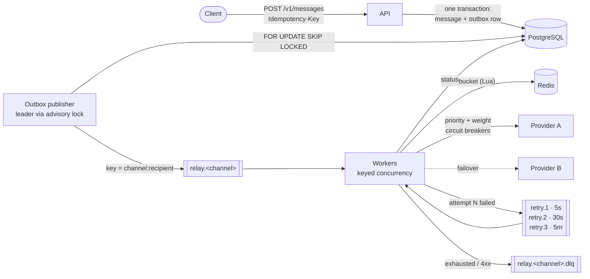

# Relay

**High-throughput, multi-channel messaging service** — SMS, e-mail, WhatsApp and push —
built the way production notification platforms are: a transactional outbox, Kafka
partitioned by recipient, provider failover with circuit breakers, fleet-wide rate limiting,
tiered retries and a dead-letter topic.

NestJS · TypeScript · Kafka (Redpanda) · PostgreSQL · Redis · Prometheus · Grafana ·
Kubernetes · k6

## Why

Sending a message is easy. Sending millions a day means answering harder questions:

- What happens to an accepted message when Kafka is down? **It waits in the outbox, never lost.**
- What if the SMS gateway dies at peak? **Traffic fails over inside the same attempt.**
- What if the client retries a timed-out request? **The idempotency key returns the original.**
- How do 12 autoscaled pods respect a 1,500 msg/s contract? **One token bucket in Redis.**
- How do two OTPs for the same person stay in order? **Kafka key per recipient.**

Each answer is a decision with trade-offs, recorded in [`docs/adr`](docs/adr/README.md).

## Architecture



One image, four roles chosen by `APP_ROLE`:

| Role        | Does                                                                     | Scales                                  |
| ----------- | ------------------------------------------------------------------------ | --------------------------------------- |
| `api`       | Validates, stores message + outbox row in one transaction, answers `202` | Horizontally (stateless)                |
| `publisher` | Drains the outbox into Kafka in batches                                  | 2 replicas, 1 active (leader lock)      |
| `worker`    | Consumes, rate-limits, routes to providers, retries, dead-letters        | Horizontally, up to the partition count |
| `migrate`   | Applies schema migrations under an advisory lock                         | Job                                     |

## Delivery guarantees

- **No accepted message is lost.** `202` means the message and its outbox row are committed.
- **At-least-once into providers, with duplicates removed at every hop** (client key, status
  guard, provider idempotency key). The one remaining window, a worker dying after a provider
  that ignores idempotency keys accepted the message, is inherent to external providers
  ([ADR 3](docs/adr/0003-at-least-once-with-idempotency-at-every-hop.md)).
- **Per-recipient order** on the main path. A message that goes through a retry tier can be
  overtaken by a newer one for the same recipient, which is what you want for OTPs.

## Run it

Requirements: Docker, Node 22 and pnpm (`corepack enable`).

```bash
pnpm install          # first time: creates pnpm-lock.yaml, commit it
make up               # Kafka, Postgres, Redis, the 4 roles, 6 simulated providers, Prometheus, Grafana
make e2e              # end-to-end tests against the running stack
```

| URL                   |                                                       |
| --------------------- | ----------------------------------------------------- |
| http://localhost:3000 | API                                                   |
| http://localhost:3030 | Grafana, dashboard "Relay — overview"                 |
| http://localhost:8081 | Redpanda Console (topics, consumer lag, DLQ contents) |
| http://localhost:9090 | Prometheus                                            |

Send a message:

```bash
curl -i localhost:3000/v1/messages \
  -H 'content-type: application/json' -H 'idempotency-key: signup-otp-42' \
  -d '{"channel":"sms","to":"+5571999999999","body":"Your code is 123456"}'

curl localhost:3000/v1/messages/<id>
```

### Break things on purpose

The simulated providers take commands at runtime, which is how the e2e tests exercise failover:

```bash
# Primary SMS gateway goes down: watch traffic move to sms-beta in Grafana
curl -X POST localhost:8091/admin/config -d '{"outage": true}'

# Degrade it instead: 30% errors, 300 ms latency
curl -X POST localhost:8091/admin/config -d '{"outage": false, "failureRate": 0.3, "latencyMs": 300}'

# Back to normal
curl -X POST localhost:8091/admin/reset
```

## Real providers

Besides the simulated gateways, Relay ships adapters for **Amazon SES** (e-mail) and
**Twilio** (SMS and WhatsApp). The router, retries, rate limits and circuit breakers do not
know which is which: each provider in the config has a `type` (`http`, `ses`, `twilio`) and
the dispatcher picks the adapter.

```bash
cp .env.example .env                                         # credentials, never committed
cp config/providers.real.example.json config/providers.real.json   # your sender and numbers
make up
curl -i localhost:3000/v1/messages -H 'content-type: application/json' \
  -d '{"channel":"sms","to":"+55719XXXXXXXX","body":"Hello from Relay"}'
```

In the example config the real providers are **priority 1** and the simulators are
**priority 2**, so a Twilio or SES failure shows failover with a real provider in the loop.

|                  | Amazon SES                                                                                 | Twilio                                                                                                                              |
| ---------------- | ------------------------------------------------------------------------------------------ | ----------------------------------------------------------------------------------------------------------------------------------- |
| Credentials      | AWS default chain: `AWS_ACCESS_KEY_ID`/`AWS_SECRET_ACCESS_KEY` locally, an IAM role on EKS | `TWILIO_ACCOUNT_SID` + API key (`TWILIO_API_KEY_SID`/`_SECRET`) or `TWILIO_AUTH_TOKEN`; `credentialsPrefix` allows several accounts |
| Sandbox / trial  | Only verified recipients; about 1 message/s                                                | Only verified numbers; enable Brazil in SMS geo permissions; WhatsApp through the Twilio sandbox number                             |
| Message id       | SES `MessageId`; Relay id sent as tag `relay_message_id`                                   | Twilio `sid`                                                                                                                        |
| Permanent errors | `MessageRejected` (e.g. unverified recipient)                                              | 21211 invalid number, 21610 unsubscribed, 21614 not mobile, 21608 unverified (trial)…                                               |
| Fail over        | Unverified sender, suspended or paused account, throttling, 5xx, timeouts                  | Invalid sender (21606, 21659), auth failure, 429, 5xx, timeouts                                                                     |

The SDK's own retries are disabled for SES (`maxAttempts: 1`), so attempts are not multiplied
by stacked retry layers. Neither SES nor Twilio's Messages API accepts an idempotency key, so
for them the duplicate window described in [ADR 3](docs/adr/0003-at-least-once-with-idempotency-at-every-hop.md)
applies.

The SES side (domain identity with DKIM, SPF and DMARC, configuration set, delivery events,
least-privilege IAM) and the delivery-receipts pipeline are provisioned by
[relay-terraform](https://github.com/LeonardoMatos07/relay-terraform).

The e2e tests and load tests always use the simulated providers (`config/providers.json`).

## API

| Method   | Path                                   |                                                                                                                                                                                 |
| -------- | -------------------------------------- | ------------------------------------------------------------------------------------------------------------------------------------------------------------------------------- |
| `POST`   | `/v1/messages`                         | `202 {id, status}` · `200` + `Idempotent-Replayed: true` for a repeated key and payload · `409` for a repeated key with a different payload · `400` with every validation error |
| `GET`    | `/v1/messages/:id`                     | Status, attempts, provider used, last error, delivery status and receipts                                                                                                       |
| `POST`   | `/v1/receipts`                         | Provider-neutral delivery receipt: `202` recorded · `200` duplicate · `404` unknown message · `400` invalid                                                                     |
| `DELETE` | `/v1/suppressions/:channel/:recipient` | Lifts a suppression                                                                                                                                                             |
| `GET`    | `/health/live`, `/health/ready`        | Liveness (process only) and readiness (dependencies of the role)                                                                                                                |
| `GET`    | `/metrics`                             | Prometheus                                                                                                                                                                      |

Set `API_KEYS` to require `X-Api-Key`.

## Templates and dynamic fields

Relay holds no templates. Each product sends its own HTML and the values to fill in
([ADR 8](docs/adr/0008-templates-rendered-by-relay.md)):

```json
{
  "channel": "email",
  "to": "ana@example.com",
  "subject": "Your code: {{code}}",
  "body": "Hi {{name}}, your code is {{code}}.",
  "html": "<h1>Hi {{name}}</h1><p>Your code is <b>{{code}}</b></p>",
  "variables": { "name": "Ana", "code": "482913" },
  "metadata": { "product": "energia", "template": "verification-code" }
}
```

`{{name}}` is replaced in `subject`, `body` and `html`; in `html` the value is HTML-escaped. A
placeholder without a variable is a `400`. `html` is for e-mail only.

## Delivery receipts

Accepting a message is not delivering it: SES can bounce it minutes later. Providers report
that back, and [relay-receipts](https://github.com/LeonardoMatos07/relay-receipts) (two Python
Lambdas, infrastructure in [relay-terraform](https://github.com/LeonardoMatos07/relay-terraform))
turns those callbacks into a neutral receipt and posts it to `POST /v1/receipts`:

```
Relay -> SES -> SNS -> SQS -> webhook-ses (raw -> neutral) -> SQS -> relay-receipts -> POST /v1/receipts
```

Relay keeps `delivery_status` (`sent < delayed < delivered < bounced/rejected < complained`) that
only moves forward, so a late event never undoes a later one, and records every receipt once
(idempotent by receipt id). A hard bounce or a complaint adds the recipient to a **suppression
list**, and later `POST /v1/messages` to that recipient answer `422`. See
[ADR 7](docs/adr/0007-delivery-receipts-and-suppression.md).

## Load test

```bash
make load RATE=2000 DURATION=5m   # k6, constant arrival rate, realistic channel mix
make report DURATION=5m           # numbers from Prometheus, as a Markdown table
```

The report reads the services' own metrics, so it measures **delivery to providers**, not only
how fast the API said "accepted".

### Results

Measured on a laptop (Intel i7-7700HQ, 4 cores / 8 threads, 16 GB RAM) running **everything on
it**, including Docker, Redpanda, Postgres, Redis, Prometheus, k6 and the simulated providers: 1 API,
1 publisher, 2 workers, realistic channel mix (`load/send.js`), simulated providers. Not a
production figure; it shows the shape of the system and where it saturates first.

| Metric                        | 250 msg/s for 2 min       | 500 msg/s for 2 min       |
| ----------------------------- | ------------------------- | ------------------------- |
| Accepted (202)                | 29,920 of 30,000 offered  | 35,585 of 60,000 offered  |
| `POST /v1/messages` p50 / p95 | 18 ms / 210 ms            | 1.48 s / 2.65 s           |
| Delivered to providers        | 29,920 (100% of accepted) | all 35,585, after the run |
| Peak delivered rate (1 min)   | 250 msg/s                 | not measured              |
| End-to-end p50 / p95 / p99    | 258 ms / 709 ms / 1.43 s  | not measured              |
| Max outbox age                | 394 ms                    | not measured              |

- **One API replica saturates near 290 accepted/s on this machine** (each request is a Postgres
  transaction: message, idempotency key and outbox row). Beyond that k6 drops iterations and
  latency climbs to seconds; no request failed. The API is stateless, so it scales out.
- **Delivery keeps up with intake.** After a deliberately bad run (a 65k backlog because no
  worker consumed three of the channels) two workers drained about 49k messages in roughly 90 s
  (about 540 msg/s).
- The k6 thresholds in `load/send.js` were crossed in both runs (p95 just above 200 ms at 250/s);
  numbers are the real ones, not tuned to pass.
- Latencies of the simulated providers are tens of milliseconds, so end-to-end times exclude real
  SES/Twilio network time.

## Kubernetes

```bash
make kind-up   # kind cluster, image, base manifests + local Redpanda/Postgres/Redis and mocks
```

`k8s/base` is environment-agnostic: probes, resource requests, non-root read-only containers,
spread constraints, PodDisruptionBudgets and HPAs. `k8s/overlays/kind` adds single-node
dependencies for local runs; a production overlay would point the same base at managed
Kafka, Postgres and Redis. HPAs need `metrics-server` in the cluster.

## Project layout

```
src/
  core/        pure domain logic, no framework: validation, idempotency fingerprint, retry
               tiers, circuit breaker, provider router, token bucket, keyed executor, UUIDv7
  api/         HTTP API (controller, repository, API-key guard)
  publisher/   outbox → Kafka, leader election
  worker/      Kafka consumers, delivery, provider client, rate limiter
  infra/       Postgres, Kafka, Redis, metrics, health, migrations
  worker/providers/  adapters: http (simulators), Amazon SES, Twilio
  mock-provider/  dependency-free fake gateway with runtime-controllable failures
test/e2e/      end-to-end tests that cause real outages through the mocks
load/          k6 scenario and the Prometheus report
k8s/           kustomize base and kind overlay
ops/           Prometheus and Grafana provisioning
docs/adr/      architecture decision records
```

The core has no dependency on NestJS, Kafka or Postgres, so the logic that decides retries,
failover and rate limits is unit-tested in isolation (`pnpm test`).

## Next steps

- OpenTelemetry tracing across API → Kafka → worker → provider.
- KEDA scaling on consumer lag instead of CPU.
- Priority lanes (OTP ahead of marketing) as separate topics with their own worker pools.
- Delivery receipts: provider webhooks updating the final status.
- A DLQ replay command.
